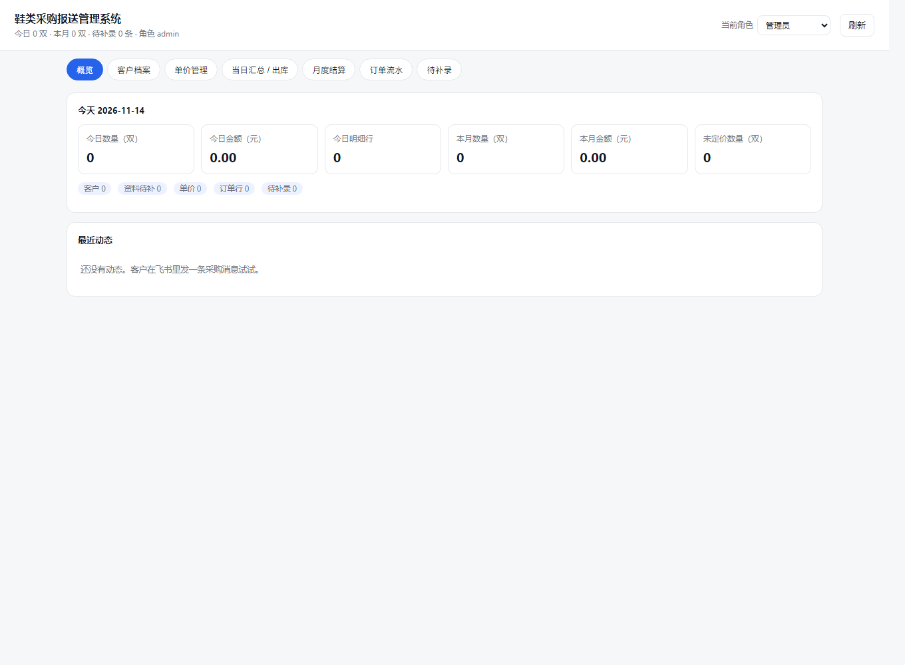
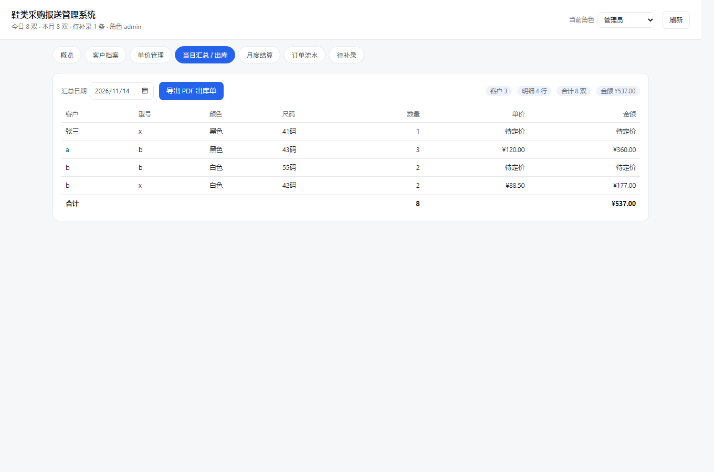
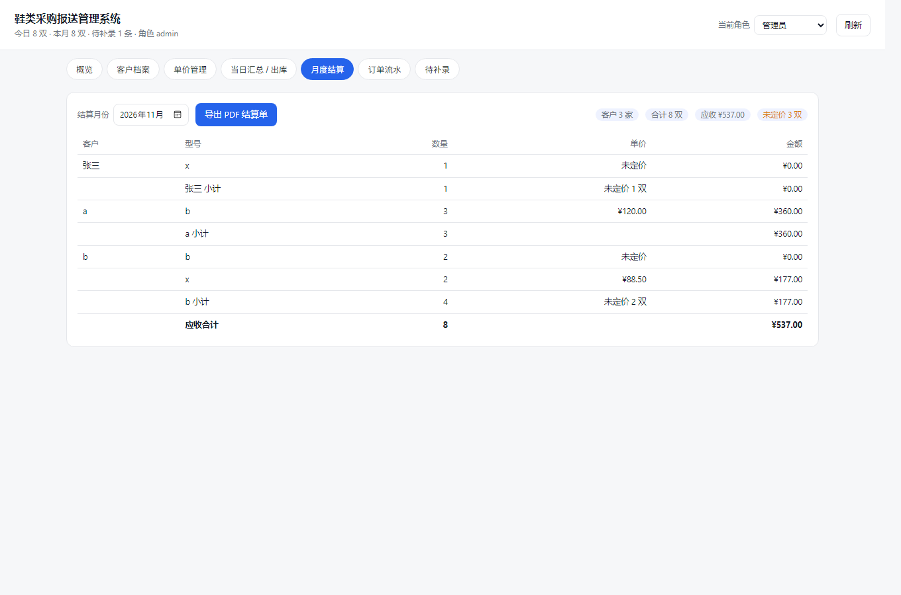
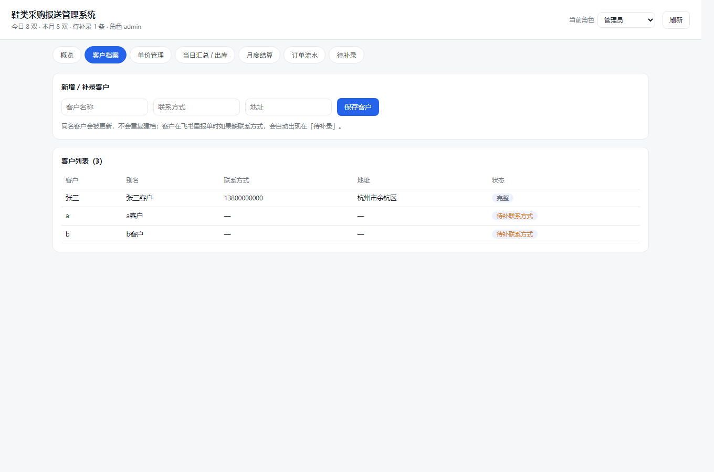

# dsh-feishu-wms · 鞋类采购报送管理系统

面向鞋类销售场景的 DSH 插件：客户在飞书里用**任意说法**报送采购需求，Agent 做语义解析并交互式补录，
后台负责客户档案、单价体系、当日汇总、出库单 PDF 与月度结算 PDF。

- 飞书接入沿用配套的 `dsh-feishu-bridge`：客户消息进入 DSH 会话，由 Agent 调用本插件的工具。
- 本插件提供：**11 个 Agent 工具**、**13 条后台 HTTP 路由**、**独立管理面板**、**DSH 设置页入口**、**系统提示词**。

## 功能对照（需求 → 实现）

| 需求 | 实现 | 验证 |
|---|---|---|
| 飞书消息接入、格式不固定 | `wms_ingest_message` + `lib/parse.js`（型号/颜色/数量/尺码/中文数字/字段乱序）+ Agent 语义理解 | R1.1 / R1.2 |
| 同客户同日多条消息数量累加 | 订单行只追加，汇总时按 `客户×型号×颜色×尺码` 合并求和 | R1.4 |
| 解析失败自动回复重述提示 | 返回 `action=retry` + 标准示例格式，同时记入待补录 | R2.1 / R2.2 |
| 客户档案维护与补录 | `wms_upsert_customer`、`/api/wms/customers`；联系方式缺失时自动追问 | R3.1 / R3.3 |
| 客户信息不全时飞书追问 | 返回 `action=need_info` + 缺字段清单，**不入库**避免脏数据 | R3.2 |
| 当天汇总（客户×型号×颜色×尺码×数量） | `wms_daily_summary`、`/api/wms/daily`、面板「当日汇总」 | R4.1 |
| 按钮导出 PDF 出库单 | 面板按钮 → `/api/wms/outbound.pdf`；Agent 侧 `wms_export_outbound` | R4.2 |
| 客户单价体系（客户+型号） | `wms_set_price` / `wms_list_prices` / `/api/wms/prices`，支持颜色专价与生效日期 | R5.1 / R5.2 |
| 月度结算（数量×单价） | `wms_monthly_settlement` / `/api/wms/settlement`，未定价部分单独标出 | R6.1 / R6.2 |
| 结算单导出 PDF | 面板按钮 → `/api/wms/settlement.pdf`；Agent 侧 `wms_export_settlement` | R6.2 |
| 角色：管理员 / 库管 / 财务 | 服务端能力表 + `x-wms-role` 请求头，越权 403 | ROLE.1-3 |
| 暂不包含：库存扣减、订单改废、收款折扣运费、定时汇总 | 未实现（有反向断言测试防止误加） | EXCL |

## 快速开始

插件已安装进 `web` profile（`dsh plugin install` 等价的 `plugin_manager install_bundle`）：

```powershell
# 1. 确认安装与运行状态
dsh plugin --profile web list
curl http://127.0.0.1:3080/api/wms/health

# 2. 打开后台面板
start http://127.0.0.1:3080/api/wms/panel

# 3. 在 DSH 里能看到这些工具（新会话生效）
#    wms_ingest_message / wms_record_order / wms_upsert_customer / wms_list_customers
#    wms_set_price / wms_list_prices / wms_daily_summary / wms_export_outbound
#    wms_monthly_settlement / wms_export_settlement / wms_list_pending
```

重新安装 / 升级：

```powershell
# 在 DSH 会话里让 Agent 执行：plugin_manager install_bundle target=<repo-path>
# 或命令行（把 <repo-path> 换成克隆下来的目录）：
dsh plugin --profile web add link:<repo-path>
```

> 改完 Host 代码（`lib/*.js`）需要重启 `dsh web` 才生效；`lib/panel.html` 是每次请求读取的，改完刷新浏览器即可。

## 飞书侧配置

1. 先在 `dsh-feishu-bridge` 里接入机器人（扫码或填 App ID/Secret），事件订阅 `im.message.receive_v1`，长连接方式。
2. 机器人会话的 workspace 选任意目录即可（本插件数据在 `~/.dsh/feishu-wms`，与会话工作区无关）。
3. 客户直接发消息，例如：

```
a客户 型号b 黑色3双43码
再补两双白色55码的b款
客户：张三，型号 X1，黑色，3双，43码
```

Agent 的处理规则写在系统提示段 `wms:procurement` 里：

- `action=recorded` → 把 `reply` 回复客户（若提示补联系方式，等客户回复后调用 `wms_upsert_customer`）。
- `action=need_info` → 把 `reply` 回复客户，等补充后再调一次。
- `action=retry` → 把 `reply` 回复客户，引导按标准格式重述。

同一会话里第二次不写客户名也能识别（按 `chat_id` 记住最近一次报单客户）。

## 后台面板

`http://127.0.0.1:3080/api/wms/panel`（也可从 DSH「设置 → 鞋类采购」进入）。

| 页签 | 内容 |
|---|---|
| 概览 | 今日/本月数量与金额、客户数、资料待补、待补录、最近动态 |
| 客户档案 | 新增 / 补录客户（同名更新），资料是否完整 |
| 单价管理 | 按「客户 + 型号（+颜色）」维护单价与生效日期 |
| 当日汇总 / 出库 | 按日期汇总 + 「导出 PDF 出库单」按钮 |
| 月度结算 | 按月份结算 + 「导出 PDF 结算单」按钮，未定价单独标红 |
| 订单流水 | 当日订单行（只读，来源可追溯） |
| 待补录 | 解析不完整 / 待补联系方式的消息队列 |

右上角可切换角色（管理员 / 库管 / 财务），所有接口按角色在服务端鉴权。页签支持深链（`#/daily`、`#/settlement`）。

面板实拍（`npm run preview` 的隔离预览，演示数据）：

| 页签 | 截图 |
|---|---|
| 概览 |  |
| 当日汇总 / 出库 |  |
| 月度结算 |  |
| 客户档案 |  |

## HTTP 接口

| 方法 | 路径 | 能力 |
|---|---|---|
| GET | `/api/wms/health` | 健康检查（数据目录、字体、角色、概览） |
| GET | `/api/wms/panel` | 后台面板 HTML |
| GET | `/api/wms/overview` | 概览数字 |
| GET/POST | `/api/wms/customers` | 客户列表 / 建档或补录 |
| GET/POST | `/api/wms/prices` | 单价列表 / 新增或修改 |
| GET/POST | `/api/wms/orders` | 订单流水 / 手工补单（管理员） |
| GET | `/api/wms/daily?date=YYYY-MM-DD` | 当日汇总 |
| GET | `/api/wms/outbound.pdf?date=` | 出库单 PDF |
| GET | `/api/wms/settlement?month=YYYY-MM` | 月度结算数据 |
| GET | `/api/wms/settlement.pdf?month=` | 结算单 PDF |
| GET | `/api/wms/pending` | 待补录列表 |
| POST | `/api/wms/pending/resolve` | 标记待补录已处理 |
| POST | `/api/wms/ingest` | 一条采购消息入库（飞书链路同款逻辑） |

角色通过请求头 `x-wms-role: admin|warehouse|finance` 传递，缺省按管理员处理（本机后台）。

## 数据与配置

- 数据目录：`~/.dsh/feishu-wms`（`WMS_DATA_DIR` 可覆盖），业务数据 `db.json`（原子写入），导出在 `exports/`。
- 配置：`WMS_OUT_DIR` 覆盖导出目录；`WMS_PDF_FONT` 指定中文字体；`company` 可在插件配置里传（PDF 抬头）。
- PDF 中文字体：自动探测 `simhei.ttf` / `Deng.ttf` / `msyh.ttf` 等，并用 fontkit 校验能否嵌入（`.ttc` 集合会被跳过）。

## 开发与测试

```powershell
npm install
npm test                     # 40 个单测 + 集成测试
npm run verify               # 需求追溯矩阵（22 项）
npm run e2e                  # 对运行中的 DSH Web 做只读端到端检查
npm run preview              # 隔离预览面板（自动灌演示数据，端口 3099，不碰线上库）
```

目录：

```
lib/index.js       插件装配：工具 / 路由 / 角色 / 系统提示
lib/store.js       数据层：客户、单价、订单、汇总、结算、待补录（JSON 原子写）
lib/parse.js       采购消息确定性解析（中文数字、字段乱序、多行项目）
lib/pdf.js         出库单 / 结算单 PDF（pdfkit + 中文字体探测）
lib/panel.html     后台管理面板（无框架、跟随系统深浅色）
lib/client.js      DSH 设置页「鞋类采购」入口
test/              parse / store / pdf / plugin（含 mock Cordis 宿主）
scripts/           verify-requirements.mjs（需求矩阵）、e2e-http.mjs（线上验收）
docs/              需求文档、需求验证报告
```

## 已知边界

- 一个消息里出现多个客户只支持「最近客户 + 显式客户名」；不会自动拆分多客户。
- 尺码按 2 位数字（35–46 等）识别，`43.5` 支持；非数字尺码（S/M/L）不识别。
- 订单只追加、不修改不作废（按需求约定）；补录错误请新增相反数量或等后续需求。
- 定时自动汇总未实现（需求明确暂不包含），汇总为按需触发。
- 修改 Host 代码后需重启 `dsh web`；客户端设置页需刷新页面。
