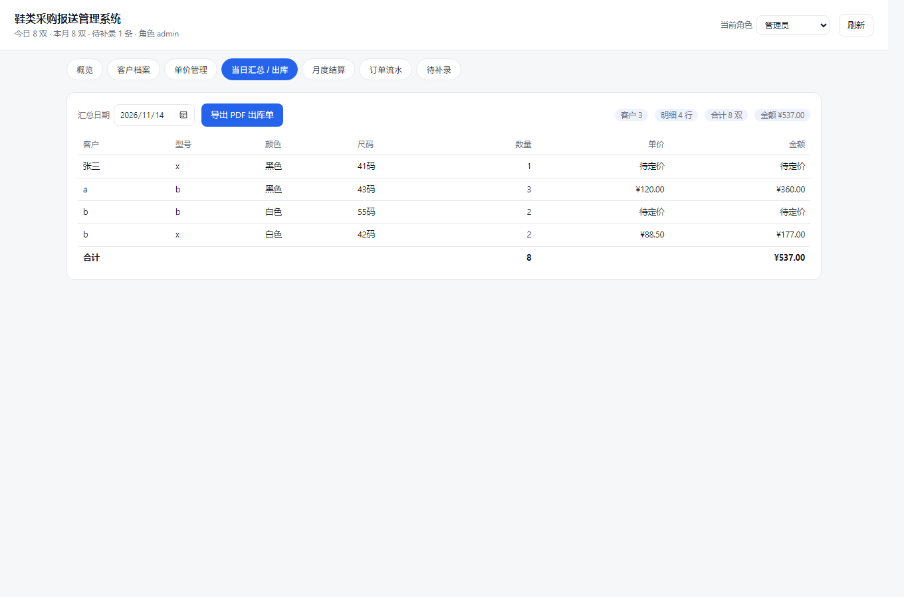
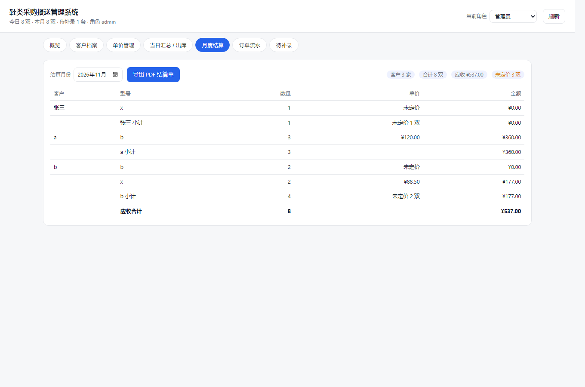
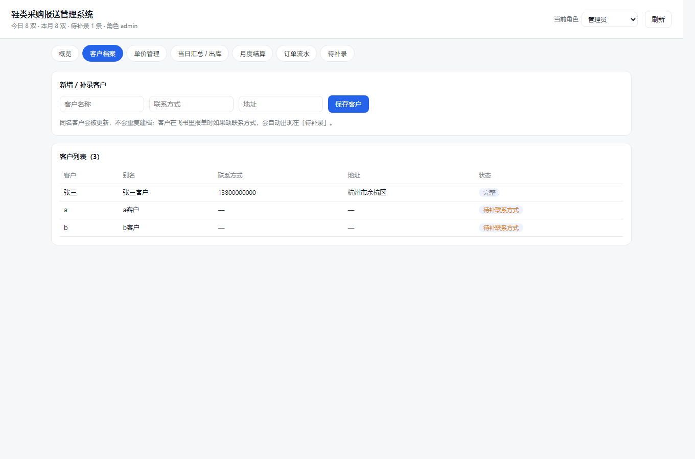
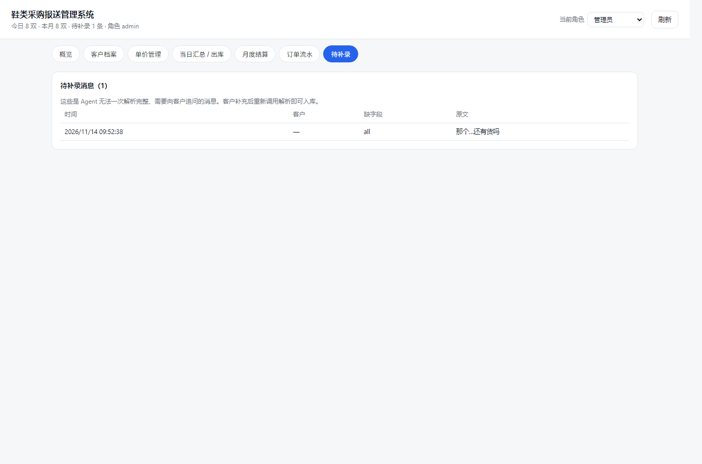

# 需求验证报告 · 鞋类采购报送管理系统

- 交付物：`dsh-feishu-wms@0.1.0`（DSH 插件 bundle，已装入 `web` profile）
- 需求来源：[`需求文档.md`](需求文档.md)
- 验证日期：2026-11-14
- 结论：**需求全部实现，22 项需求验收全部 PASS，40 项自动化测试全部通过，线上实例 12 项端到端检查全部通过。**

## 一、怎么验证的

| 层次 | 手段 | 结果 |
|---|---|---|
| 需求层 | `npm run verify` → 逐条对照需求文档，22 项断言 | 22 PASS / 0 FAIL |
| 单元 + 集成 | `npm test` → 解析 / 数据层 / PDF / 插件装配与路由 | 40 PASS / 0 FAIL |
| 线上实例 | `npm run e2e`（对 `127.0.0.1:3080` 真实 HTTP） | 12 PASS / 0 FAIL |
| 装配层 | `plugin_manager install_bundle` → `application: applied`；`cordis_inspect_query Tool.listTools` 可见 11 个 `wms_*` 工具 | 通过 |

复现命令：

```powershell
cd feishu-wms
npm install
npm test
npm run verify
npm run e2e        # 需要 dsh web 正在运行
```

## 二、需求追溯矩阵（`npm run verify` 实际输出）

```
鞋类采购报送管理系统 · 需求追溯矩阵
==============================================================================================================
编号     状态   需求点                                            验证方式
--------------------------------------------------------------------------------------------------------------
R1.1     PASS   飞书采购消息接入并生成结构化订单                  客户 a / 型号 b / 黑色 / 3 双 / 43 码 → 已入库
R1.2     PASS   格式不固定的消息也能解析（「再补两双白色55码的b… 中文数字 / 字段乱序 / 省略客户名（会话上下文）均识别
R1.3     PASS   五个结构化字段齐全：客户名称 / 鞋型号 / 颜色 / … 订单行 2 条，字段齐全
R1.4     PASS   同一客户同一天多条消息，数量自动累加              黑色 43 码：3 + 2 = 5 双；当日合计 7 双
R2.1     PASS   无法解析时给出重新描述提示 + 标准示例格式         返回 action=retry，话术含标准示例
R2.2     PASS   解析失败的消息进入待补录队列，供后续跟进          待补录 1 条
R3.1     PASS   后台可维护客户档案（新增 / 补录 / 查询）          新增 / 同名更新 / 列表查询均正常
R3.2     PASS   客户信息不全时 Agent 通过飞书追问（不落库，避免… 缺尺码 → 追问「尺码」，未产生订单
R3.3     PASS   客户在聊天中补录后自动入库（联系方式补全）        新建档 → 提示补联系方式 → 补录后 profileComplete=true
R4.1     PASS   后台不定时汇总当天数据：客户 × 型号 × 颜色 ×… 当日 3 行 / 8 双 / 客户 2 家
R4.2     PASS   按钮导出 PDF 出库单（后台路由 + Agent 工具两条…  HTTP PDF 14983 字节；工具落盘 14983 字节
R5.1     PASS   客户单价体系：按「客户 + 型号」新增 / 修改 / 查询 新增 120 → 修改 125（同一条，不重复）；查询可见
R5.2     PASS   订单金额 = 数量 × 该客户对应单价                 a · b · 黑色 · 43：5 双 × 125 = 625
R6.1     PASS   每月自动汇总各客户采购数量                        2 家客户 / 8 双
R6.2     PASS   月度结算金额按「数量 × 客户单价」计算并可导出 … 应收 ¥875；PDF 15879 字节
ROLE.1   PASS   管理员可维护客户与单价                            客户建档 200
ROLE.2   PASS   库管可汇总 / 导出出库单，不能做结算               出库单 200 / 结算 403
ROLE.3   PASS   财务可结算 / 导出结算单，不能导出出库单或改单价   结算单 200 / 出库单 403 / 改价 403
FLOW     PASS   端到端业务流程：消息 → 解析 → 入库 → 汇总 →… 5 双 / ¥497.50，出库单与结算单 PDF 均生成
EXCL     PASS   暂不包含项确实没有实现（库存扣减 / 订单改废 / … 路由 / 工具 / 数据层均无这些能力
UI       PASS   后台面板与 DSH 设置页入口可用                     面板 200；中文字体：simhei.ttf
DEPLOY   PASS   插件可被 DSH 加载的前提齐备（manifest / patch /… dsh-feishu-wms@0.1.0
--------------------------------------------------------------------------------------------------------------
合计 22 项：通过 22，失败 0
```

## 三、线上实例验证（`npm run e2e`）

```
PASS  GET /api/wms/health            build=wms-0.1.0 data=~/.dsh/feishu-wms
PASS  中文字体可嵌入                 C:/Windows/Fonts/simhei.ttf
PASS  三角色注册                     admin/warehouse/finance
PASS  GET /api/wms/panel             24644 字节
PASS  面板含三大功能块               当日汇总 / 月度结算 / 单价管理
PASS  GET /api/wms/overview          客户 0 / 订单行 0（线上库为新库）
PASS  GET /api/wms/daily             0 行 / 0 双
PASS  GET /api/wms/settlement        应收 ¥0
PASS  GET /api/wms/outbound.pdf      12895 字节
PASS  GET /api/wms/settlement.pdf    12457 字节
PASS  财务导出出库单被拒绝           HTTP 403
PASS  库管查看结算被拒绝             HTTP 403
```

另外确认：`Tool.listTools` 里 11 个 `wms_*` 工具已对 Agent 可见；插件数据目录
`~/.dsh/feishu-wms/` 已创建（`db.json` + `exports/`）。

> 说明：线上库故意保持干净，未用 `--write` 往真实库写测试订单；写入链路已由上面
> 「需求矩阵 + 40 个自动化测试」在同一份代码上完整覆盖。需要连写入一起验时执行
> `npm run e2e -- --write`（会写入 `e2e-` 前缀的测试客户）。

## 四、自我迭代记录（发现问题 → 修复 → 复测）

| # | 问题 | 现象 | 修复 |
|---|---|---|---|
| 1 | 尺码正则带 `/g`，`match()` 返回整串匹配 | 所有消息都丢尺码 → 永远追问「尺码」 | 去掉全局标志，`SIZE_RE` 改单次匹配 |
| 2 | 中文数量归一化 | `normalizeQuantity('两双')` 返回 NaN | 先剥离「双/对/pairs」单位再转数字 |
| 3 | pdfkit 嵌入 `.ttc` 字体集合崩溃 | `this.font.createSubset is not a function`（雅黑/宋体集合） | 用 fontkit 预校验字体能力，只挑可嵌入的 `.ttf`；探测失败降级 Helvetica |
| 4 | 单价生效日期早于订单日期 | 给历史订单补价后金额仍为 0 | 加「未到生效日期则取最早价兜底」，颜色专价仍优先 |
| 5 | 群聊里客户省略客户名 | `再补两双白色55码的b款` 被判缺客户 | 按 `chat_id` 记住最近报单客户，未写客户名时沿用 |
| 6 | 客户不存在时无法报价 | Agent 先报价后建客户会报错 | `setPrice` 对未知客户自动建档（标记待补联系方式） |
| 7 | `plugin_manager install_bundle` 卡死 | `timed out waiting for the writer lock` | 定位为 `package.json.lock` 0 字节陈旧锁（atomic-write 无法接管空记录），确认无并发安装后删除重试 |
| 8 | 编辑脚本把 `lib/pdf.js` 写成非 UTF-8 | 文件读取报 `invalid UTF-8` | 改用文件工具重写该文件，并在 AGENTS.md 记录教训（不要用 shell 重写源码） |

## 五、界面实拍（隔离预览，不碰线上库）

`npm run preview` 会用最小宿主替身起一个只服务 `/api/wms/*` 的临时服务并灌入演示数据，
再用无头 Edge 截图，确认页签切换、表格、合计与按钮都按预期渲染。

| 页签 | 截图 |
|---|---|
| 当日汇总 / 出库（4 行 / 8 双 / ¥537.00，含待定价行） |  |
| 月度结算（按客户小计 + 应收合计 + 未定价提示） |  |
| 客户档案（别名、资料完整度、补录表单） |  |
| 待补录（解析失败的消息队列） |  |

截图过程中发现并修复的缺陷：

- 页签点击只重渲染、不重新拉数据 → 首次进入「客户档案 / 单价管理」是空表。
  改为 `switchTab()` 先 `refreshAll()` 再渲染，并支持 `#/daily` 深链与 `hashchange`。

## 六、覆盖范围与已知局限

覆盖：需求文档二、三、四章的全部条目；五章「暂不包含」用反向断言守护（路由 / 工具 / 数据层均无库存、改废、折扣、定时汇总能力）。

未覆盖 / 明确局限：

1. **真实飞书端到端**：本次未用真实飞书 App 发一条消息（需要已配置的机器人凭据与开放平台权限）。
   消息接入链路由 `/api/wms/ingest` 与 `wms_ingest_message` 同源代码验证；飞书收发本身属于
   [`dsh-feishu-bridge`](../dsh-feishu-bridge) 的既有能力。
2. **浏览器视觉验收范围**：面板用无头 Edge 对「隔离预览服务」截图核对（见上节），
   未在真实 DSH 页面内点按操作；client 设置页入口只做了模块语法与 manifest 校验，需刷新页面后人工确认。
   深浅色主题由 CSS 变量跟随系统，截图仅为浅色。
3. **`.ttc` 字体**：pdfkit 不支持字体集合，若机器上只有 `.ttc` 需用 `WMS_PDF_FONT` 指一个 `.ttf`。
4. **多客户同条消息**：不支持一条消息拆多个客户（会按「最近客户 + 显式客户名」处理）。
5. **Agent 语义理解**：规则解析器覆盖常见写法；更口语化的表达依靠 LLM 直接调用
   `wms_record_order`（结构化）兜底。
